<div align="center">


[](https://bestow-ui.com)

[](https://www.npmjs.com/package/@bestow-ui/react)
[](https://www.npmjs.com/package/@bestow-ui/react)
[](https://github.com/Dev-BestOW)

</div>

---

## 🧩 만들고 있는 것

<div align="center">

| | 프로젝트 | 한 줄 소개 |
| :-: | --- | --- |
| 🎨 | [**BestOW UI**](https://github.com/Dev-BestOW/BestOW-UI) | 한국 서비스를 위한 접근성 검증 React 디자인 시스템 — 약관·인증번호·전화·사업자번호·주소 입력, KWCAG 2.2 대응 근거, 대표색 하나로 다크·브랜드 테마 · [문서](https://bestow-ui.com) · [Storybook](https://bestow-ui.com/storybook/) |
| 🔍 | [**korean-seo-skill**](https://github.com/Dev-BestOW/korean-seo-skill) | 네이버 서치어드바이저·구글 Search Central 기준으로 웹 페이지·사이트맵·RSS·블로그 제목을 점검하는 Claude Code 스킬 |
| ✍️ | [**astro-blog**](https://github.com/Dev-BestOW/astro-blog) | 기술 블로그 [jiwon-seok.com](https://jiwon-seok.com) 의 소스 (Astro) |

</div>

---

## 🛠️ Tech Stack

<div align="center">


<br />


<br />


</div>

---

## 🎯 Current Focus

```text
📝 입력 경험   전화번호·사업자번호·주소·금액 — 매일 쓰지만 잘 만들기 어려운 칸
♿️ 웹 접근성    KWCAG 2.2 를 문서가 아니라 테스트(axe·키보드·스크린리더)로
🔎 검색 노출   네이버·구글 웹마스터 기준을 자동 점검으로
💬 물어보세요  디자인 시스템, 접근성, Claude Code
```

---

## 📈 Contribution Graph

<div align="center">

[](https://github.com/Dev-BestOW)

<picture>
  <source media="(prefers-color-scheme: dark)" srcset="https://raw.githubusercontent.com/Dev-BestOW/Dev-BestOW/output/github-contribution-grid-snake-dark.svg" />
  
</picture>

</div>

---

## 📫 Connect

<div align="center">

[](https://jiwon-seok.com)
[](https://bestow-ui.com)
[](https://www.npmjs.com/org/bestow-ui)

</div>

<div align="center">


*누구나 쓸 수 있는 화면을, 근거와 함께.*

</div>
